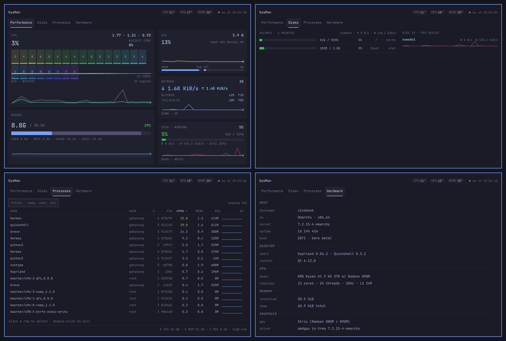
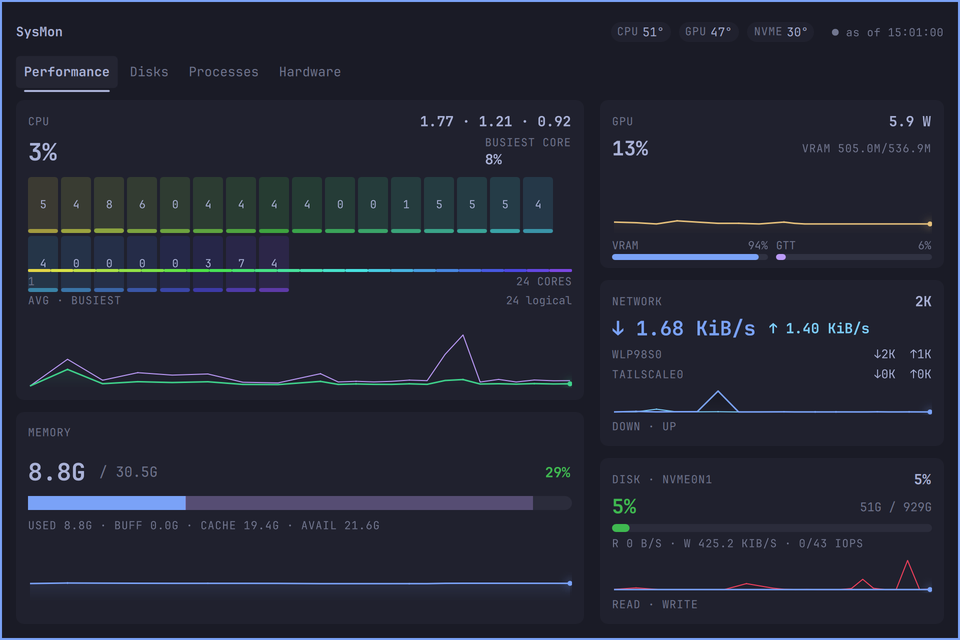
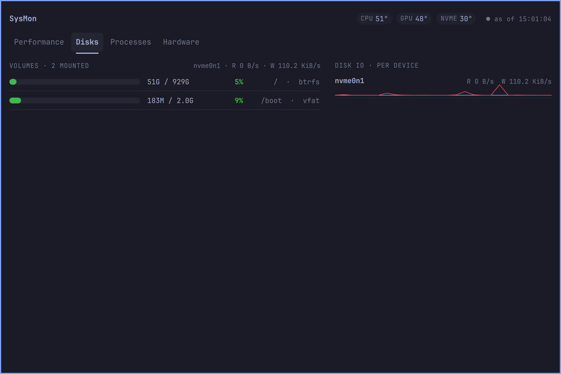
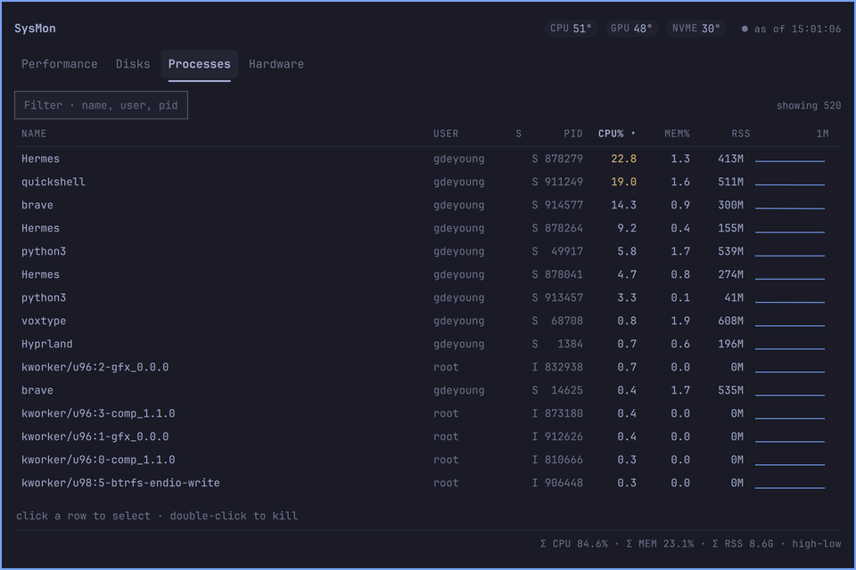
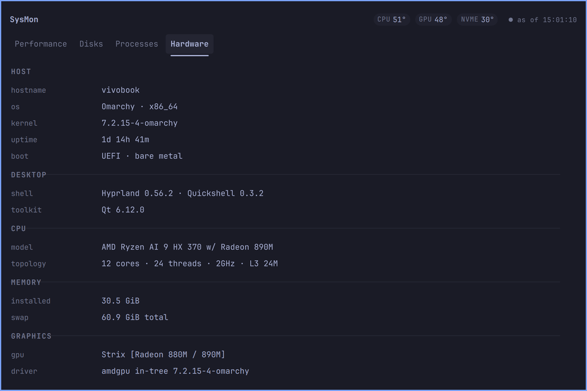

# Omarchy SysMon



Live system stats in the [Omarchy](https://omarchy.org/) bar — a compact letter+meter strip that expands into a fixed-frame, four-tab task-manager popup: performance cards (CPU + per-core grid, memory, GPU, network, disk), per-volume and per-device disk I/O, a filterable process table with a one-minute CPU history per process, and a fastfetch-grade hardware inventory.

```
bar (compact):   ▎M  ▎C  ▎N  ▎D        ← click to open
                 └ hover for values
```

## Screenshots

### The bar

One letter, one 5px meter per stat — the numbers live in the hover tooltip. Zero noise until you click:


### Performance tab

Everything, live-scrolling: CPU as total % (green) with the busiest core overlaid (violet) over a per-core grid, memory with a used / buffers / cache / available legend, GPU load with power draw and VRAM/GTT meters, network, and disk. Ring buffers run whether or not the popup is open, so it opens with minutes of warm history already drawn:



### Disks tab

A gauge for every mounted volume with the backing device's live read/write rate, and a per-device R/W spark beside it — local filesystems only, deduped by source device, so multi-mountpoint btrfs shows once:



### Processes tab

The task-manager view: filter by name, user or pid; click a column to sort; a one-minute CPU spark per process. Select a row, press **End process**, and a confirm strip offers TERM first — if the process survives, it becomes **Force kill (9)**. There is no kill control on the rows, so nothing misfires on a hover. Footer totals follow the filter:



### Hardware tab

Fastfetch-grade machine inventory, probed once when the popup opens — no root, no Python, no extra dependencies: vendor/product/board, BIOS version + date, CPU (model, cores/threads, max clock, L3), memory, GPU, displays + native mode, physical storage + size, network controllers with their kernel drivers, audio cards, battery model/technology/health, Bluetooth, USB/PCI device counts, OS + kernel, and uptime. Anything your hardware doesn't expose just hides.



### What's new

- **v0.6.0** — Look-and-feel pass modeled on the KDE Plasma SysMon plasmoid. Fixed 960×640 frame. Performance rebuilt as cards: CPU total + busiest core, 24-cell per-core grid, memory legend, GPU power/VRAM/GTT, network, disk. Processes: filter box, six sortable columns, one-minute CPU history per row, kill-confirm strip (TERM → Force kill). Disks: per-device R/W sparks. Hardware: one fastfetch-style list. IPC gains `tab hw`, `filter`, `sort`, `select`, `scroll` and a richer `status`. Probe fixes: disk resolution through LUKS (`lsblk -s` inverse walk), kernel-thread names (`migration/0` no longer renders as `0`), Qt version via `qtpaths`. `Text.PlainText` extended to every text fed by device, interface or process strings.
- **v0.5.1** — Security: hardware-derived strings (DMI product/board, device names) rendered with `textFormat: Text.PlainText` so markup-shaped device strings can never trigger rich-text loading. Probe: concise GPU name on bracketless-vendor devices (Intel). Tests green.
- **v0.5.0** — Hardware tab: fastfetch-grade unprivileged inventory (new `sysinfo-probe.sh`, popup widened to fit).

Forked from [vm.sysmem](https://github.com/jhonoryza/omarchy-sysmem) by jhonoryza (MIT).

## Bar

Four groups, one letter + one 5px level meter each (numbers live in the hover tooltip and the popup). `barMode: values` in the plugin settings restores the original full readouts (`M 10.5/30.5G  C 12%  N ↓1.2M↑240K  D 44G/930G`).

| Letter | Stat | Bar fill | Source |
|---|---|---|---|
| M | RAM used % | green/amber/red (70/90) | `/proc/meminfo` |
| C | CPU utilization | green/amber/red | `/proc/stat` jiffy deltas |
| N | ↓/↑ rate | blue, log-scale activity (1 Gbit/s ≈ full) | `/sys/class/net/*/statistics` deltas |
| D | whole-disk used % | green/amber/red | `df` + `lsblk` |

Left-click opens the detail popup. Right/middle-click refreshes.

## Popup

A task-manager view anchored under the widget: a fixed 960×640 frame, four tabs — **Performance / Disks / Processes / Hardware**. Only the process and hardware lists scroll; everything else fits.

- **Header** — CPU/GPU/NVMe temperatures, threshold-colored, plus the sample time.
- **Performance** — left column: **C · CPU** (total % green + busiest core violet, per-core grid, load averages) and **M · Memory** (master gauge, amber time-series, used/buffers/cache/available legend). Right column: **G · GPU** (load, power draw, VRAM and GTT meters — hides when no GPU reports), **N · Network** (down + up, top interfaces), **D · Disk**.
- **Disks** — a gauge per mounted volume with the device's live R/W, and per-device R/W sparks.
- **Processes** — filter, sortable columns, a one-minute CPU spark per process, and a two-step kill behind a confirm strip: TERM first; if the process survives, **Force kill (9)**. A process you don't own ends in a visible *no permission* line, never a silent failure.
- **Hardware** — the inventory in one fastfetch-style list.

While the popup is open the charts tick at 1 s and the process table at 2 s; history ring buffers (180 samples) are kept whether or not the popup is open, so it opens with ~3–6 minutes of warm history. The per-process CPU history is kept only while the popup is open, so the `1m` column fills in over its first minute.

VRAM is popup-only on purpose: on the machine this was built on the 512 MB carve-out sits pinned near full, which makes it noise in a bar but useful context in a detail view.

## IPC

```bash
omarchy-shell gdeyoung.sysmon open            # open the popup
omarchy-shell gdeyoung.sysmon close
omarchy-shell gdeyoung.sysmon toggle
omarchy-shell gdeyoung.sysmon tab perf        # perf | disk | procs | hw
omarchy-shell gdeyoung.sysmon refresh         # all instances
omarchy-shell gdeyoung.sysmon filter sleep    # processes: substring on name / user / pid ("" clears)
omarchy-shell gdeyoung.sysmon sort rss        # cpu | mem | pid | name | user | rss
omarchy-shell gdeyoung.sysmon select 411987   # processes: select the row for a pid
omarchy-shell gdeyoung.sysmon scroll 600      # processes: scroll the list to y (clamped)
omarchy-shell gdeyoung.sysmon status          # JSON: open state, tab, frame geometry, series head,
                                               #      last probe values, process view + kill state, hardware
```

The verbs exist for scripts and tests. Killing is deliberately not one of them: it takes a click on the confirm strip.

## Requirements

- Omarchy 4.x with its Quickshell bar (uses `qs.Commons` / `qs.Ui` and the `BarWidget` base)
- Bash + coreutils (`awk`, `df`) — no other dependencies

## Install

```bash
git clone https://github.com/gdeyoung/omarchy-sysmon.git
cd omarchy-sysmon
./install.sh
omarchy restart shell
```

The installer is idempotent and non-destructive. It installs the widget, enables it, places it in the bar's right section, and — if the `vm.sysmem` widget is present — disables it (SysMon supersedes it).

## Uninstall

```bash
omarchy plugin remove gdeyoung.sysmon
omarchy restart shell
```

## How it works

A `Process` runs `sysmon.sh` every tick; the script prints exactly one JSON line (32 keys: per-core jiffies, load, swap, temps, GPU counters, disk IO, per-interface bytes, mounted volumes) and the widget parses it. Cumulative counters are converted to rates in the widget between ticks — the probe stays stateless (~150 ms per run). While the popup is open a second probe (`procprobe.sh`, ~30 ms) feeds the process table every 2 s, and `sysinfo-probe.sh` runs once per open (~0.7 s) for the Hardware tab. Charts are one `Canvas` sparkline each; no extra processes while idle.

## License

MIT
